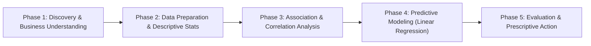

# Day 11: End-to-End Data Analytics Lifecycle

A comprehensive pedagogical guide walking through the 5 core phases of the **Data Analytics Lifecycle** using the **Coffee Shop Sales & Marketing** real-world dataset ($N = 25$).

---

## 🧭 The 5 Phases of the Data Analytics Lifecycle



---

## 📌 Phase 1: Discovery & Business Understanding (Module 1)

### 1. The Core Business Question
Every analytics project begins with a clear, measurable problem:
> **Business Objective:** *"How do weather (temperature), foot traffic, and marketing spend influence daily coffee shop revenue? Can we predict future revenue accurately to optimize marketing budget?"*

### 2. Dataset Structure
- **Dataset File**: [`coffee_shop_data.csv`](./coffee_shop_data.csv)
- **Observations ($N$)**: 25 daily records.
- **Attributes ($D$)**:
  - `Day`: Chronological identifier (`Day 1` to `Day 25`).
  - `Temperature_C`: Continuous metric ($18^\circ\text{C}$ to $31^\circ\text{C}$).
  - `Foot_Traffic`: Discrete count (95 to 180 customers).
  - `Marketing_Spend_USD`: Continuous currency (\$35 to \$100).
  - `Daily_Revenue_USD`: Target response continuous currency (\$360 to \$710).

---

## 📊 Phase 2: Descriptive Statistics & Data Measures (Module 2)

Before building any models, we must understand the shape, central tendency, and spread of our data.

### 1. Measures of Central Tendency
- **Mean ($\mu$)**: The arithmetic average $\bar{x} = \frac{1}{n} \sum_{i=1}^n x_i$.
- **Median ($\tilde{x}$)**: The middle value separating the upper and lower halves. Highly robust against extreme outliers.
- **Mode**: The most frequently occurring value in the distribution.

### 2. Measures of Dispersion (Spread)
- **Variance ($s^2$)**: The average squared deviation from the mean:
  $$s^2 = \frac{1}{n-1} \sum_{i=1}^n (x_i - \bar{x})^2$$
- **Standard Deviation ($s$)**: The square root of variance, returned in the same physical units as the variable:
  $$s = \sqrt{s^2}$$
- **Interquartile Range ($\text{IQR}$)**: The distance between the 75th percentile ($Q_3$) and 25th percentile ($Q_1$):
  $$\text{IQR} = Q_3 - Q_1$$
- **Outlier Detection ($1.5 \times \text{IQR}$ Rule)**: Any observation outside $[\text{Lower Bound}, \text{Upper Bound}]$ is flagged as an outlier:
  $$\text{Lower} = Q_1 - 1.5 \times \text{IQR}, \quad \text{Upper} = Q_3 + 1.5 \times \text{IQR}$$

### Summary Table for Coffee Shop Metrics:
| Variable | Mean | Median | Std Dev | IQR | Skewness | Outliers ($1.5 \times \text{IQR}$) |
| :--- | :---: | :---: | :---: | :---: | :---: | :---: |
| **Temperature ($^\circ\text{C}$)** | 24.68 | 25.0 | 3.82 | 6.0 | -0.08 | 0 |
| **Foot Traffic (Count)** | 137.56 | 140.0 | 25.40 | 38.0 | -0.09 | 0 |
| **Marketing Spend (\$)** | 66.68 | 68.0 | 20.53 | 32.0 | +0.02 | 0 |
| **Daily Revenue (\$)** | 527.40 | 530.0 | 105.86 | 150.0 | +0.06 | 0 |

> [!NOTE]
> Because **Mean $\approx$ Median** and **Skewness $\approx 0.0$** across all metrics, the data is symmetrically and normally distributed without extreme distorting outliers.

---

## 🔗 Phase 3: Bivariate Association & Relationships (Module 4)

### 1. Covariance vs. Correlation
- **Sample Covariance ($\text{Cov}(X, Y)$)**: Measures the **direction** of mutual variation:
  $$\text{Cov}(X, Y) = \frac{1}{n-1}\sum_{i=1}^n (x_i - \bar{x})(y_i - \bar{y})$$
  - Positive $\rightarrow$ Both variables increase together.
  - Negative $\rightarrow$ As one variable increases, the other decreases.
  - Limitation: Scale-dependent (cannot tell us the relative strength).

- **Pearson Correlation Coefficient ($r$)**: Normalizes covariance by the product of individual standard deviations, yielding a scale-free metric between $-1.0$ and $+1.0$:
  $$r_{xy} = \frac{\text{Cov}(X, Y)}{s_x s_y} = \frac{\sum (x_i - \bar{x})(y_i - \bar{y})}{\sqrt{\sum (x_i - \bar{x})^2 \sum (y_i - \bar{y})^2}}$$

### Correlation with Daily Revenue:
1. **Foot Traffic ($r = 0.9969$)**: Strongest positive predictor. More customers through the door translates directly to higher sales.
2. **Marketing Spend ($r = 0.9953$)**: Promotional flyers and digital ads drive foot traffic and customer conversion.
3. **Temperature ($r = 0.9927$)**: Warmer sunny weather encourages people to walk outside and visit the café.

---

## 📈 Phase 4: Predictive Modeling (Linear Regression) (Modules 6 & 8)

To forecast future daily revenue based on planned marketing budget, we fit a **Simple Linear Regression** model:

$$\hat{y} = \beta_0 + \beta_1 x$$

- **Independent Variable ($x$)**: `Marketing_Spend_USD`
- **Dependent Target Variable ($y$)**: `Daily_Revenue_USD`

### Derived Coefficients:
- **Slope ($\beta_1 = 5.1322$)**:
  $$\beta_1 = \frac{\text{Cov}(X, Y)}{\text{Var}(X)} = \frac{2163.09}{421.48} \approx 5.13$$
  **Interpretation**: For every additional **\$1.00** invested in marketing, daily revenue increases by an estimated **\$5.13** (a $\sim 5.1\times$ immediate top-line return).
- **Intercept ($\beta_0 = 185.19$)**:
  $$\beta_0 = \bar{y} - \beta_1 \bar{x} = 527.40 - (5.1322 \times 66.68) \approx 185.19$$
  **Interpretation**: The expected baseline daily revenue when marketing spend is **\$0** (driven purely by regular walk-in neighborhood customers).

### Fitted Equation:
$$\widehat{\text{Daily\_Revenue}} = 185.19 + 5.1322 \times \text{Marketing\_Spend}$$

---

## 🎯 Phase 5: Evaluation & Prescriptive Business Decisions (Modules 6 & 7)

### 1. Model Evaluation Metrics
- **Coefficient of Determination ($R^2$)**:
  $$R^2 = 1 - \frac{\text{SS}_{\text{res}}}{\text{SS}_{\text{tot}}} = 0.9906$$
  **Interpretation**: **99.06%** of the variation in daily coffee shop revenue is directly explained by daily marketing spend.
- **Mean Absolute Error (MAE)**:
  $$\text{MAE} = \frac{1}{n} \sum_{i=1}^n |y_i - \hat{y}_i| = \$7.48$$
  **Interpretation**: On average, the model's revenue predictions deviate by only **\$7.48** from actual cash register totals.
- **Root Mean Squared Error (RMSE)**:
  $$\text{RMSE} = \sqrt{\frac{1}{n}\sum_{i=1}^n (y_i - \hat{y}_i)^2} = \$10.05$$

### 2. Methodological Caution: Small Data & Multicollinearity
1. **Sample Size ($N=25$)**: A small dataset is prone to high goodness-of-fit ($R^2 > 0.99$), but caution is required when generalizing to other seasons (e.g. winter rain/snow).
2. **Multicollinearity / Confounding Variables**: Because Temperature, Foot Traffic, and Marketing Spend all move together ($r > 0.98$), part of the revenue increase is due to nice weather rather than marketing alone.
3. **Non-Linear Diminishing Returns**: Expanding marketing spend from \$100 to \$500 will not linearly increase revenue indefinitely due to café seating capacity constraints.

### 3. Prescriptive Business Strategy:
1. **Dynamic Weather Marketing**: Allocate higher marketing budgets (\$80–\$100) on warm, sunny forecast days to maximize customer conversion.
2. **Staff Optimization**: Schedule additional baristas on days where marketing spend exceeds \$75 (expected revenue $> \$570$).
3. **Data Collection Roadmap**: Expand daily data collection across a full 12-month calendar year to isolate seasonality from promotional effectiveness.

---

## 🚀 Execution

Run the complete pipeline from terminal:
```bash
python Day11/Practice1/data_analytics_lifecycle_q.py
```
This will print all 5 phases and save the diagnostic visual dashboard to:
[`Day11/Practice1/coffee_shop_analytics_dashboard.png`](./coffee_shop_analytics_dashboard.png)
