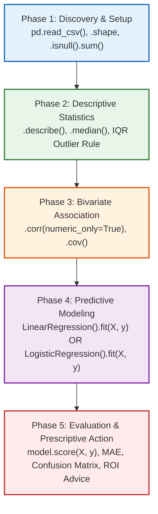

# Day 11: End-to-End Data Analytics Lifecycle & Predictive Modeling

Comprehensive reference guide, mathematical formulations, architectural templates, and practical troubleshooting for the **End-to-End Data Analytics Lifecycle** covered across Practices 1 through 5.

---

## 📌 Table of Contents
1. [The 5-Phase Master Lifecycle Architecture](#-the-5-phase-master-lifecycle-architecture)
2. [Module & Practice Manifest](#-module--practice-manifest)
3. [Phase-by-Phase Deep Dive & Minimal Built-ins](#-phase-by-phase-deep-dive--minimal-built-ins)
   - [Phase 1: Discovery & Data Setup](#phase-1-discovery--data-setup)
   - [Phase 2: Descriptive Statistics & Dispersion](#phase-2-descriptive-statistics--dispersion)
   - [Phase 3: Bivariate Association & Correlation](#phase-3-bivariate-association--correlation)
   - [Phase 4: Predictive Modeling (Regression & Classification)](#phase-4-predictive-modeling)
   - [Phase 5: Evaluation & Prescriptive Action](#phase-5-evaluation--prescriptive-action)
4. [⚠️ The 8 Traps Where Learners Get Stuck (And How to Fix Them)](#-the-8-traps-where-learners-get-stuck)
5. [📊 Quick Revision Cheat-Sheet](#-quick-revision-cheat-sheet)

---

## 🏛️ The 5-Phase Master Lifecycle Architecture

Every exercise across Day 11 implements the **Facade Design Pattern** to execute the analytics pipeline in a clean, chronological workflow:



### The Orchestrator Facade
```python
def run_analytics_lifecycle():
    df = phase_1_discovery_and_setup()       # Returns cleaned DataFrame
    df = phase_2_descriptive_statistics(df)  # Returns df after outlier checks
    df = phase_3_bivariate_association(df)   # Returns df with correlation findings
    model, X, y = phase_4_predictive_modeling(df) # Returns trained model & tensors
    phase_5_evaluation_and_reporting(model, X, y, df) # Generates score & business decisions
```

---

## 📁 Module & Practice Manifest

| Practice | Domain | Target Variable | Problem Type | Script | Dataset |
| :--- | :--- | :--- | :--- | :--- | :--- |
| **Practice 1** | Local Coffee Shop | `Daily_Revenue_USD` | Linear Regression | [`Practice1/data_analytics_lifecycle_q.py`](./Practice1/data_analytics_lifecycle_q.py) | [`Practice1/coffee_shop_data.csv`](./Practice1/coffee_shop_data.csv) |
| **Practice 2** | NBA Player Cohorts | `Birth Date` | Date Analytics / Paradox | [`Practice2/nba_birthday_analytics_exercise.py`](./Practice2/nba_birthday_analytics_exercise.py) | [`Practice2/player_data.csv`](./Practice2/player_data.csv) |
| **Practice 3** | Employee HR | `Weekly_Tasks_Completed` | Linear Regression | [`Practice3/employee_analytics_exercise.py`](./Practice3/employee_analytics_exercise.py) | [`Practice3/employee_productivity.csv`](./Practice3/employee_productivity.csv) |
| **Practice 4A** | Healthcare Vitals | `Systolic_BP` | Linear Regression | [`Practice4/healthcare_analytics_exercise.py`](./Practice4/healthcare_analytics_exercise.py) | [`Practice4/patient_health_data.csv`](./Practice4/patient_health_data.csv) |
| **Practice 4B** | Hypertension Risk | `High_Risk_Hypertension` | Logistic Regression (Binary) | [`Practice4/healthcare_classification_exercise.py`](./Practice4/healthcare_classification_exercise.py) | [`Practice4/patient_classification_data.csv`](./Practice4/patient_classification_data.csv) |
| **Practice 5** | E-Commerce Retail | `Annual_Spend_USD` | Linear Regression | [`Practice5/ecommerce_analytics_exercise.py`](./Practice5/ecommerce_analytics_exercise.py) | [`Practice5/ecommerce_customer_data.csv`](./Practice5/ecommerce_customer_data.csv) |

---

## 🔍 Phase-by-Phase Deep Dive & Minimal Built-ins

### Phase 1: Discovery & Data Setup
- **Goal**: Ingest data, inspect dimensions, verify data types and integrity.
- **Minimal Code**:
```python
from pathlib import Path
import pandas as pd

csv_path = Path(__file__).resolve().parent / "dataset.csv"

def phase_1_discovery_and_setup():
    df = pd.read_csv(csv_path)
    print(df.head())
    print(f"Shape: {df.shape}")
    print("Missing Values:\n", df.isnull().sum())
    return df
```
- **Key Concepts**:
  - `df.shape`: Returns `(n_rows, n_columns)`.
  - `df.isnull().sum()`: Sums boolean null masks per column. If all values are $0$, data completeness is confirmed.

---

### Phase 2: Descriptive Statistics & Dispersion
- **Goal**: Measure Central Tendency (Mean, Median), Dispersion (Standard Deviation, Variance, IQR), and identify Outliers.
- **Mathematical Formulations**:
  - **Sample Mean ($\bar{x}$)**:
    $$\bar{x} = \frac{1}{n}\sum_{i=1}^n x_i$$
  - **Sample Variance ($s^2$) & Standard Deviation ($s$)**:
    $$s^2 = \frac{1}{n-1}\sum_{i=1}^n (x_i - \bar{x})^2, \quad s = \sqrt{s^2}$$
  - **Interquartile Range ($\text{IQR}$)**:
    $$\text{IQR} = Q_3 - Q_1$$
  - **Tukey's $1.5 \times \text{IQR}$ Outlier Bounds**:
    $$\text{Lower Bound} = Q_1 - 1.5 \times \text{IQR}, \quad \text{Upper Bound} = Q_3 + 1.5 \times \text{IQR}$$
- **Minimal Code**:
```python
def phase_2_descriptive_statistics(df):
    col = df['Target_Metric']
    print(col.describe())
    print(f"Variance: {col.var():.2f}")
    
    # 1.5 * IQR Outlier Rule
    q1 = col.quantile(0.25)
    q3 = col.quantile(0.75)
    iqr = q3 - q1
    lower_bound = q1 - 1.5 * iqr
    upper_bound = q3 + 1.5 * iqr
    outliers = col[(col < lower_bound) | (col > upper_bound)]
    print(f"IQR: {iqr:.2f}, Outliers Count: {len(outliers)}")
    return df
```
> [!NOTE]
> If **$\text{Mean} \approx \text{Median}$**, the feature distribution is symmetrical and roughly bell-shaped. If $\text{Mean} \gg \text{Median}$, the distribution has heavy positive (right-hand) skewness.

---

### Phase 3: Bivariate Association & Correlation
- **Goal**: Measure how two variables vary together.
- **Mathematical Formulations**:
  - **Sample Covariance ($\text{Cov}(X, Y)$)**:
    $$\text{Cov}(X, Y) = \frac{1}{n-1}\sum_{i=1}^n (x_i - \bar{x})(y_i - \bar{y})$$
  - **Pearson Correlation Coefficient ($r$)**:
    $$r_{xy} = \frac{\text{Cov}(X, Y)}{s_x s_y} = \frac{\sum (x_i - \bar{x})(y_i - \bar{y})}{\sqrt{\sum (x_i - \bar{x})^2 \sum (y_i - \bar{y})^2}}$$
- **Minimal Code**:
```python
def phase_3_bivariate_association(df):
    corr = df.corr(numeric_only=True)
    print(corr.round(4))
    print(f"Key Correlation: r = {corr.loc['Feature_X', 'Target_Y']:.4f}")
    return df
```
- **Interpretation Guidelines**:
  - $r \in [+0.8, +1.0]$: Very strong positive linear relationship.
  - $r \in [-0.8, -1.0]$: Very strong inverse/negative linear relationship.
  - $r \approx 0.0$: No linear relationship (variables are uncorrelated).

---

### Phase 4: Predictive Modeling

#### Option A: Continuous Response $\rightarrow$ Simple Linear Regression
$$\hat{y} = \beta_0 + \beta_1 x$$
- **Slope ($\beta_1$)**:
  $$\beta_1 = \frac{\text{Cov}(X, Y)}{\text{Var}(X)} = \frac{\sum (x_i - \bar{x})(y_i - \bar{y})}{\sum (x_i - \bar{x})^2}$$
  *Interpretation*: The expected change in target $y$ for every 1-unit increase in feature $x$.
- **Intercept ($\beta_0$)**:
  $$\beta_0 = \bar{y} - \beta_1 \bar{x}$$
  *Interpretation*: The baseline expected value of target $y$ when feature $x = 0$.

```python
from sklearn.linear_model import LinearRegression

def phase_4_predictive_modeling(df):
    X = df[['Feature_X']]   # Double brackets: Must be 2D DataFrame!
    y = df['Target_Y']      # Single bracket: 1D Series
    model = LinearRegression().fit(X, y)
    print(f"Slope (beta_1): {model.coef_[0]:.4f}")
    print(f"Intercept (beta_0): {model.intercept_:.4f}")
    return model, X, y
```

#### Option B: Binary Response ($0 / 1$) $\rightarrow$ Logistic Regression
$$P(Y=1|X) = \sigma(z) = \frac{1}{1 + e^{-(\beta_0 + \beta_1 x_1 + \beta_2 x_2)}}$$

```python
from sklearn.linear_model import LogisticRegression

def phase_3_classification_modeling(df):
    X = df[['Feature_1', 'Feature_2']]
    y = df['Binary_Class']
    model = LogisticRegression().fit(X, y)
    return model, X, y
```

---

### Phase 5: Evaluation & Prescriptive Action

#### Evaluation Metrics for Regression
- **Coefficient of Determination ($R^2$)**:
  $$R^2 = 1 - \frac{\text{SS}_{\text{res}}}{\text{SS}_{\text{tot}}} = 1 - \frac{\sum (y_i - \hat{y}_i)^2}{\sum (y_i - \bar{y})^2}$$
  *Interpretation*: The proportion of variance in $y$ explained by the independent variable(s) $X$.
- **Mean Absolute Error (MAE)**:
  $$\text{MAE} = \frac{1}{n}\sum_{i=1}^n |y_i - \hat{y}_i|$$
  *Interpretation*: Average absolute prediction error in the target's original units (e.g., dollars, blood pressure points).

```python
from sklearn.metrics import mean_absolute_error

def phase_5_evaluation_and_reporting(model, X, y, df):
    y_pred = model.predict(X)
    r2 = model.score(X, y)  # Inbuilt R-squared calculation
    mae = mean_absolute_error(y, y_pred)
    print(f"R-squared: {r2:.4f}, MAE: ${mae:.2f}")
    print("Prescriptive Action: [Actionable business / clinical decision]")
```

#### Evaluation Metrics for Classification
- **Accuracy**:
  $$\text{Accuracy} = \frac{\text{TP} + \text{TN}}{\text{TP} + \text{TN} + \text{FP} + \text{FN}}$$
- **Confusion Matrix**:
  $$\begin{pmatrix} \text{TN} & \text{FP} \\ \text{FN} & \text{TP} \end{pmatrix}$$

```python
from sklearn.metrics import accuracy_score, confusion_matrix

def phase_4_model_evaluation(model, X, y):
    y_pred = model.predict(X)
    print(f"Accuracy: {accuracy_score(y, y_pred) * 100:.2f}%")
    print("Confusion Matrix:\n", confusion_matrix(y, y_pred))
```

---

## ⚠️ The 8 Traps Where Learners Get Stuck

### ❌ Trap 1: 1D vs 2D Feature Matrix Dimension Error
- **Error**: `ValueError: Expected 2D array, got 1D array instead... Reshape your data either using array.reshape(-1, 1)...`
- **Cause**: Passing a 1D Series `df['Feature']` to `model.fit()`. Scikit-learn requires $X$ to have shape `(n_samples, n_features)`.
- **Fix**: Use double brackets `df[['Feature']]`.

### ❌ Trap 2: Forgetting `return` Between Pipeline Phases
- **Error**: `AttributeError: 'NoneType' object has no attribute 'describe'` or `'NoneType' object has no attribute 'predict'`
- **Cause**: Writing a phase function without returning the DataFrame or trained model.
- **Fix**: Always return:
  - `return df` (Phases 1, 2, 3)
  - `return model, X, y` (Phase 4)

### ❌ Trap 3: Relative Path `FileNotFoundError`
- **Error**: `FileNotFoundError: [Errno 2] No such file or directory: 'coffee_shop_data.csv'`
- **Cause**: Terminal working directory (`os.getcwd()`) differs from script directory.
- **Fix**: Resolve parent path dynamically:
  ```python
  csv_path = Path(__file__).resolve().parent / "filename.csv"
  ```

### ❌ Trap 4: Non-Numeric Column Crash in `df.corr()` (Pandas 2.0+)
- **Error**: `TypeError: unsupported operand type(s) for -: 'str' and 'str'`
- **Cause**: Dataset contains string identifiers (`Employee_ID`, `Patient_ID`, `Day`).
- **Fix**: Always use `df.corr(numeric_only=True)`.

### ❌ Trap 5: Missing Parentheses in Pandas Boolean Masking
- **Error**: `ValueError: The truth value of a Series is ambiguous.`
- **Cause**: Using Python's logical `or` instead of bitwise `|`, or omitting parentheses.
- **Fix**:
  ```python
  # Correct:
  outliers = col[(col < lower_bound) | (col > upper_bound)]
  ```

### ❌ Trap 6: Confusing Pearson's $r$ with $R^2$
- **Distinction**:
  - Pearson's $r \in [-1.0, +1.0]$: Direction and strength of linear relationship between two continuous variables.
  - $R^2 \in [0.0, 1.0]$: Percentage of target variance accounted for by the regression model. In simple linear regression, $R^2 = (r)^2$.

### ❌ Trap 7: Misinterpreting Scikit-Learn Confusion Matrix Layout
- **Scikit-Learn Layout**:
  - Row 0 = Ground Truth Negative ($0$) $\rightarrow$ `[TN, FP]`
  - Row 1 = Ground Truth Positive ($1$) $\rightarrow$ `[FN, TP]`
  - Column 0 = Predicted Negative ($0$)
  - Column 1 = Predicted Positive ($1$)

### ❌ Trap 8: Small-Dataset Overfitting Risk ($N = 25$)
- **Viva / Interview Question**: *"Your model achieved $R^2 = 0.99$. Is it ready for production?"*
- **Accurate Answer**:
  1. **No**. Small datasets ($N=25$) naturally yield inflated $R^2$ values due to limited variance exposure.
  2. **Multicollinearity / Confounders**: In the coffee shop dataset, warmer weather increases foot traffic, which in turn increases revenue; marketing spend is partially confounded by weather.
  3. **Capacity Constraints**: Linear extrapolation beyond the maximum observed spend ignores physical seating limits and diminishing marginal returns.

---

## 📊 Quick Revision Cheat-Sheet

| Task | Inbuilt Python / Pandas / Scikit-Learn One-Liner |
| :--- | :--- |
| **Missing Values Audit** | `df.isnull().sum()` |
| **Parametric Summary** | `df.describe().T[['count', 'mean', 'std', 'min', 'max']]` |
| **Non-Parametric Median** | `df.median(numeric_only=True)` |
| **Variance** | `df.var(numeric_only=True)` |
| **IQR Calculation** | `q1 = col.quantile(0.25); q3 = col.quantile(0.75); iqr = q3 - q1` |
| **Outlier Detection** | `col[(col < q1 - 1.5 * iqr) \| (col > q3 + 1.5 * iqr)]` |
| **Covariance Matrix** | `df.cov(numeric_only=True)` |
| **Correlation Matrix** | `df.corr(numeric_only=True)` |
| **Linear Regression Fit** | `model = LinearRegression().fit(df[['Feature']], df['Target'])` |
| **Extract Slope & Intercept**| `model.coef_[0]`, `model.intercept_` |
| **Inbuilt $R^2$ Score** | `model.score(X, y)` |
| **Mean Absolute Error** | `mean_absolute_error(y, model.predict(X))` |
| **Logistic Regression Fit**| `model = LogisticRegression().fit(df[['F1', 'F2']], df['Target'])` |
| **Classification Accuracy**| `accuracy_score(y, model.predict(X))` |
| **Confusion Matrix** | `confusion_matrix(y, model.predict(X))` |
