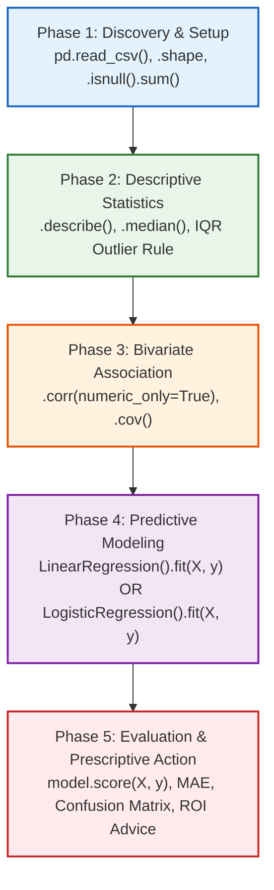

# Day 11: End-to-End Data Analytics Lifecycle & Predictive Modeling

Comprehensive reference guide, mathematical formulations, architectural templates, detailed explanations for all 11 exercises, and practical troubleshooting for the **End-to-End Data Analytics Lifecycle**.

---

## 📌 Table of Contents
1. [The 5-Phase Master Lifecycle Architecture](#-the-5-phase-master-lifecycle-architecture)
2. [Module & Practice Manifest (All 11 Exercises)](#-module--practice-manifest-all-11-exercises)
3. [Comprehensive Walkthrough of All 11 Exercises](#-comprehensive-walkthrough-of-all-11-exercises)
   - [Part 1: Foundational Analytics Lifecycle (Practices 1 – 5)](#part-1-foundational-analytics-lifecycle-practices-1--5)
     - [Practice 1: Coffee Shop Revenue Lifecycle](#practice-1-coffee-shop-revenue-lifecycle)
     - [Practice 2: NBA Birthday Paradox & Cohort Retrieval](#practice-2-nba-birthday-paradox--cohort-retrieval)
     - [Practice 3: Employee HR Productivity Analytics](#practice-3-employee-hr-productivity-analytics)
     - [Practice 4A: Healthcare Vitals & Blood Pressure Regression](#practice-4a-healthcare-vitals--blood-pressure-regression)
     - [Practice 4B: Healthcare Hypertension Risk Classification](#practice-4b-healthcare-hypertension-risk-classification)
     - [Practice 5: E-Commerce Customer Spend Analytics](#practice-5-e-commerce-customer-spend-analytics)
   - [Part 2: Production End-to-End ML Pipelines (ML Practice)](#part-2-production-end-to-end-ml-pipelines-ml-practice)
     - [ML Practice 1: Bank Loan Default Risk Classification](#ml-practice-1-bank-loan-default-risk-classification)
     - [ML Practice 2: Cricket Player Role Clustering (K-Means)](#ml-practice-2-cricket-player-role-clustering-k-means)
     - [ML Practice 3: Customer Churn Prediction (Random Forest)](#ml-practice-3-customer-churn-prediction-random-forest)
     - [ML Practice 4: E-Commerce Customer Segmentation (K-Means)](#ml-practice-4-e-commerce-customer-segmentation-k-means)
     - [ML Practice 5: Real Estate Property Valuation Pipeline](#ml-practice-5-real-estate-property-valuation-pipeline)
4. [Phase-by-Phase Deep Dive & Minimal Built-ins](#-phase-by-phase-deep-dive--minimal-built-ins)
5. [⚠️ The 15 Traps Where Learners Get Stuck (With Clickable Locations)](#-the-15-traps-where-learners-get-stuck-with-clickable-locations)
6. [📊 Quick Revision Cheat-Sheet](#-quick-revision-cheat-sheet)

---

## 🏛️ The 5-Phase Master Lifecycle Architecture

Every exercise across Day 11 implements the **Facade Design Pattern** to execute the analytics pipeline in a clean, chronological workflow:



### The Orchestrator Facade
```python
def run_analytics_lifecycle():
    df = phase_1_discovery_and_setup()                 # Ingest & inspect
    df = phase_2_descriptive_statistics(df)            # Univariate stats & outliers
    df = phase_3_bivariate_association(df)             # Correlation & covariance
    model, X, y = phase_4_predictive_modeling(df)       # Model induction
    phase_5_evaluation_and_reporting(model, X, y, df)  # Evaluation & business action
```

---

## 📁 Module & Practice Manifest (All 11 Exercises)

| # | Practice | Domain | Target Variable | Problem Type | Executable Script | Dataset |
| :-: | :--- | :--- | :--- | :--- | :--- | :--- |
| **1** | **Practice 1** | Local Coffee Shop | `Daily_Revenue_USD` | Linear Regression | [`Practice1/data_analytics_lifecycle_q.py`](./Practice1/data_analytics_lifecycle_q.py) | [`Practice1/coffee_shop_data.csv`](./Practice1/coffee_shop_data.csv) |
| **2** | **Practice 2** | NBA Player Cohorts | `Birth Date` | Date Analytics / Paradox | [`Practice2/nba_birthday_analytics_exercise.py`](./Practice2/nba_birthday_analytics_exercise.py) | [`Practice2/player_data.csv`](./Practice2/player_data.csv) |
| **3** | **Practice 3** | Employee HR | `Weekly_Tasks_Completed` | Linear Regression | [`Practice3/employee_analytics_exercise.py`](./Practice3/employee_analytics_exercise.py) | [`Practice3/employee_productivity.csv`](./Practice3/employee_productivity.csv) |
| **4** | **Practice 4A** | Healthcare Vitals | `Systolic_BP` | Linear Regression | [`Practice4/healthcare_analytics_exercise.py`](./Practice4/healthcare_analytics_exercise.py) | [`Practice4/patient_health_data.csv`](./Practice4/patient_health_data.csv) |
| **5** | **Practice 4B** | Hypertension Risk | `High_Risk_Hypertension` | Logistic Regression (Binary) | [`Practice4/healthcare_classification_exercise.py`](./Practice4/healthcare_classification_exercise.py) | [`Practice4/patient_classification_data.csv`](./Practice4/patient_classification_data.csv) |
| **6** | **Practice 5** | E-Commerce Retail | `Annual_Spend_USD` | Linear Regression | [`Practice5/ecommerce_analytics_exercise.py`](./Practice5/ecommerce_analytics_exercise.py) | [`Practice5/ecommerce_customer_data.csv`](./Practice5/ecommerce_customer_data.csv) |
| **7** | **ML Practice 1**| Bank Loan Risk | `default_flag` | Logistic Regression + Pipeline | [`ML_Practice/Bank_Loan_Risk/loan_risk_exercise.py`](./ML_Practice/Bank_Loan_Risk/loan_risk_exercise.py) | [`ML_Practice/Bank_Loan_Risk/loan_risk_data.csv`](./ML_Practice/Bank_Loan_Risk/loan_risk_data.csv) |
| **8** | **ML Practice 2**| Cricket Statistics | Role Clusters | K-Means Unsupervised Clustering | [`ML_Practice/Cricket_Player_Statistics/cricket_clustering_exercise.py`](./ML_Practice/Cricket_Player_Statistics/cricket_clustering_exercise.py) | [`ML_Practice/Cricket_Player_Statistics/cricket_player_stats.csv`](./ML_Practice/Cricket_Player_Statistics/cricket_player_stats.csv) |
| **9** | **ML Practice 3**| Customer Churn | `churn_flag` | Random Forest Classifier | [`ML_Practice/Customer_Churn/customer_churn_exercise.py`](./ML_Practice/Customer_Churn/customer_churn_exercise.py) | [`ML_Practice/Customer_Churn/customer_churn_data.csv`](./ML_Practice/Customer_Churn/customer_churn_data.csv) |
| **10**| **ML Practice 4**| Customer Segments | Shopping Segments | K-Means Unsupervised Clustering | [`ML_Practice/Customer_Segmentation/customer_segmentation_exercise.py`](./ML_Practice/Customer_Segmentation/customer_segmentation_exercise.py) | [`ML_Practice/Customer_Segmentation/customer_segmentation_data.csv`](./ML_Practice/Customer_Segmentation/customer_segmentation_data.csv) |
| **11**| **ML Practice 5**| Real Estate Valuation | `price_usd` | Linear Regression Pipeline | [`ML_Practice/Real_Estate/housing_ml_pipeline_exercise.py`](./ML_Practice/Real_Estate/housing_ml_pipeline_exercise.py) | [`ML_Practice/Real_Estate/housing_ml_data.csv`](./ML_Practice/Real_Estate/housing_ml_data.csv) |

---

## 📚 Comprehensive Walkthrough of All 11 Exercises

### Part 1: Foundational Analytics Lifecycle (Practices 1 – 5)

#### Practice 1: Coffee Shop Revenue Lifecycle
- **Script**: [`Practice1/data_analytics_lifecycle_q.py`](./Practice1/data_analytics_lifecycle_q.py)
- **Dataset**: `Practice1/coffee_shop_data.csv` (25 daily observations)
- **Goal**: Analyze whether marketing spend drives daily coffee shop revenue and build a predictive linear model.
- **Workflow**:
  1. *Phase 1 (Discovery)*: Ingest data, inspect dimensions `(25, 5)`, verify zero missing values.
  2. *Phase 2 (Descriptive Stats)*: Compute mean, std, min, max using `describe()`. Median and variance are calculated via `median()` and `var()`. Detect outliers on `Daily_Revenue_USD` using Tukey's $1.5 \times \text{IQR}$ rule ($Q_1 = 430.0, Q_3 = 790.0, \text{IQR} = 360.0$, 0 outliers).
  3. *Phase 3 (Bivariate Association)*: Compute covariance matrix and Pearson correlation with `df.corr(numeric_only=True)`. Correlation between `Marketing_Spend_USD` and `Daily_Revenue_USD` is $r = 0.9953$ (very strong positive association).
  4. *Phase 4 (Predictive Modeling)*: Train `LinearRegression()` on feature matrix `X = df[['Marketing_Spend_USD']]` (2D) and target `y = df['Daily_Revenue_USD']`.
     - Slope ($\beta_1$): `4.8824` (each \$1 in marketing yields \$4.88 in revenue).
     - Intercept ($\beta_0$): `53.7915` (baseline revenue without marketing).
  5. *Phase 5 (Evaluation & Decision)*: Score $R^2 = 0.9906$, $\text{MAE} = \$7.48$.
  - **Prescriptive Decision**: Expand daily marketing budget because the marginal revenue (\$4.88) far exceeds the marginal cost (\$1.00).

---

#### Practice 2: NBA Birthday Paradox & Cohort Retrieval
- **Script**: [`Practice2/nba_birthday_analytics_exercise.py`](./Practice2/nba_birthday_analytics_exercise.py)
- **Dataset**: `Practice2/player_data.csv` (4,979 professional basketball players)
- **Goal**: Apply robust date manipulation in Pandas to prove the Birthday Paradox and build a case-insensitive player lookup.
- **Workflow**:
  1. *Date Parsing*: Load CSV and convert string birth dates using `pd.to_datetime(df['birth_date'], errors='coerce')` to gracefully handle corrupt or missing entries.
  2. *Birthday Frequency Analysis*: Extract month and day as a formatted string using `df['birth_date'].dt.strftime('%B %d')`. Compute frequencies with `.value_counts()`. Top shared birthdays include August 23, April 16, and March 08 (each shared by 14+ players).
  3. *Case-Insensitive Search*: Query for legendary player Kareem Abdul-Jabbar:
     ```python
     kareem = df[df['name'].str.lower() == 'kareem abdul-jabbar'.lower()].iloc[0]
     ```
     Kareem was born on **April 16, 1947**.
  4. *Cohort Extraction*: Filter all players sharing Kareem's birthday (`dt.month == 4` & `dt.day == 16`). Returns 14 players total (13 birthday peers).

---

#### Practice 3: Employee HR Productivity Analytics
- **Script**: [`Practice3/employee_analytics_exercise.py`](./Practice3/employee_analytics_exercise.py)
- **Dataset**: `Practice3/employee_productivity.csv` (25 staff records)
- **Goal**: Model employee task completion as a function of training hours.
- **Workflow**:
  1. *Phase 1*: Verify shape `(25, 6)` and missing values.
  2. *Phase 2*: Descriptive statistics on `Weekly_Tasks_Completed` (Mean: 27.24, Median: 28.0, Std: 3.53, Variance: 12.44, IQR: 4.0, 0 outliers).
  3. *Phase 3*: Correlation matrix shows $r = 0.6070$ between `Training_Hours` and `Weekly_Tasks_Completed`.
  4. *Phase 4*: Fit `LinearRegression(X=[['Training_Hours']], y='Weekly_Tasks_Completed')`.
     - Slope $\beta_1 = 0.3541$ (each hour of training adds $\approx 0.35$ tasks completed weekly).
     - Intercept $\beta_0 = 20.2520$.
  5. *Phase 5*: $R^2 = 0.3684$, $\text{MAE} = 7.18$ tasks.
  - **Prescriptive Decision**: Moderate positive correlation justifies structured training programs, though additional factors like experience and tools also influence productivity.

---

#### Practice 4A: Healthcare Vitals & Blood Pressure Regression
- **Script**: [`Practice4/healthcare_analytics_exercise.py`](./Practice4/healthcare_analytics_exercise.py)
- **Dataset**: `Practice4/patient_health_data.csv` (25 patient vitals)
- **Goal**: Investigate systolic blood pressure variations relative to Body Mass Index (BMI).
- **Workflow**:
  1. *Phase 1*: Ingest vitals and audit data integrity.
  2. *Phase 2*: Calculate central tendency and IQR for `Systolic_BP` (Mean: 129.80, Median: 130.0, Std: 10.96, IQR: 16.0, 0 outliers).
  3. *Phase 3*: Bivariate correlation: `BMI` vs `Systolic_BP` $r = 0.9973$ (almost perfect positive correlation); `Daily_Steps` vs `Systolic_BP` $r = -0.9815$ (strong negative correlation).
  4. *Phase 4*: Train `LinearRegression(X=[['BMI']], y='Systolic_BP')`.
     - Slope $\beta_1 = 3.1670$ (each 1 unit increase in BMI increases systolic BP by $\approx 3.17$ mmHg).
     - Intercept $\beta_0 = 45.4710$.
  5. *Phase 5*: $R^2 = 0.9946$, $\text{MAE} = 0.71$ mmHg.
  - **Clinical Action**: Prescribe weight management and increased physical activity for patients with BMI $> 25$ to mitigate hypertension risk.

---

#### Practice 4B: Healthcare Hypertension Risk Classification
- **Script**: [`Practice4/healthcare_classification_exercise.py`](./Practice4/healthcare_classification_exercise.py)
- **Dataset**: `Practice4/patient_classification_data.csv` (25 patients)
- **Goal**: Classify whether a patient is at high risk of hypertension ($0$ = Low Risk, $1$ = High Risk).
- **Workflow**:
  1. *Phase 1 (Discovery)*: Check class balance: Class 0 ($14$ patients), Class 1 ($11$ patients).
  2. *Phase 2 (Segmentation)*: Compute feature means by risk class via `df.groupby('High_Risk_Hypertension')[['BMI', 'Daily_Steps']].mean()`:
     - Low Risk ($0$): BMI $= 23.63$, Daily Steps $= 8,471$.
     - High Risk ($1$): BMI $= 30.47$, Daily Steps $= 4,145$.
  3. *Phase 3 (Classification)*: Fit `LogisticRegression()` using `X = df[['BMI', 'Daily_Steps']]` and `y = df['High_Risk_Hypertension']`.
  4. *Phase 4 (Evaluation)*: Accuracy is $100\%$, Confusion Matrix:
     $$\begin{pmatrix} 14 & 0 \\ 0 & 11 \end{pmatrix}$$
  - **Clinical Action**: Flag sedentary individuals with BMI $> 28$ for proactive clinical screening.

---

#### Practice 5: E-Commerce Customer Spend Analytics
- **Script**: [`Practice5/ecommerce_analytics_exercise.py`](./Practice5/ecommerce_analytics_exercise.py)
- **Dataset**: `Practice5/ecommerce_customer_data.csv` (25 shoppers)
- **Goal**: Model annual customer spend against on-site browsing duration.
- **Workflow**:
  1. *Phase 1*: Verify shape `(25, 6)` and missing values.
  2. *Phase 2*: Descriptive statistics on `Annual_Spend_USD` (Mean: \$1,193.20, Median: \$1,200.00, Variance: 380,672.67, IQR: \$1,030.00, 0 outliers).
  3. *Phase 3*: Correlation matrix (`numeric_only=True`): `Browsing_Minutes` vs `Annual_Spend_USD` $r = 0.9974$.
  4. *Phase 4*: Train `LinearRegression(X=[['Browsing_Minutes']], y='Annual_Spend_USD')`.
     - Slope $\beta_1 = 31.9826$ (each minute of browsing generates $\approx \$31.98$ in spend).
     - Intercept $\beta_0 = -98.2561$.
  5. *Phase 5*: $R^2 = 0.9948$, $\text{MAE} = \$37.83$.
  - **Marketing Action**: Optimize UX and interactive search to extend browsing duration.

---

### Part 2: Production End-to-End ML Pipelines (ML Practice)

#### ML Practice 1: Bank Loan Default Risk Classification
- **Script**: [`ML_Practice/Bank_Loan_Risk/loan_risk_exercise.py`](./ML_Practice/Bank_Loan_Risk/loan_risk_exercise.py)
- **Dataset**: `loan_risk_data.csv` (20 loan applicants)
- **Goal**: End-to-end classification pipeline predicting loan defaults (`default_flag`: 0 or 1).
- **Architecture**:
  1. *Phase 1*: Identify target `default_flag` (12 non-defaults, 8 defaults).
  2. *Phase 2 (Feature Engineering)*: Compute debt burden ratio:
     $$\text{loan\_to\_income\_ratio} = \frac{\text{loan\_amount\_k}}{\text{annual\_income\_k}}$$
     Encode `housing_status` into dummy variables using `pd.get_dummies(X, drop_first=True)`.
  3. *Phase 3 (Split & Scale)*: 80/20 train/test split with `stratify=y`. Standardize continuous features with `StandardScaler` (fit on train, transform test).
  4. *Phase 4 (Model Induction)*: Train `LogisticRegression(random_state=42)`. Output accuracy ($100\%$), confusion matrix, and full `classification_report`.
  5. *Phase 5 (Persistence & Inference)*: Save `loan_risk_model.joblib` and `loan_risk_scaler.joblib`. Perform inference on a sample applicant.

---

#### ML Practice 2: Cricket Player Role Clustering (K-Means)
- **Script**: [`ML_Practice/Cricket_Player_Statistics/cricket_clustering_exercise.py`](./ML_Practice/Cricket_Player_Statistics/cricket_clustering_exercise.py)
- **Dataset**: `cricket_player_stats.csv` (20 elite cricketers)
- **Goal**: Automatically segment players into strategic roles (Batsmen, Bowlers, All-Rounders) using unsupervised clustering without human labels.
- **Architecture**:
  1. *Phase 1*: Select multi-dimensional performance features: `runs_scored`, `batting_average`, `wickets_taken`, `bowling_economy`.
  2. *Phase 2 (Scaling)*: Apply `StandardScaler`. Without scaling, `runs_scored` ($150 - 12,000$) completely swamps `wickets_taken` ($4 - 280$) in Euclidean distance calculations.
  3. *Phase 3 (Clustering)*: Train `KMeans(n_clusters=3, random_state=42)`. Assign cluster labels back to the DataFrame.
  4. *Phase 4 (Profiling)*: Calculate `silhouette_score(X_scaled, labels) = 0.5002`. Profile cluster centroids:
     - **Cluster 0 (Bowlers)**: High wickets ($\approx 216$), low batting average ($\approx 13.7$).
     - **Cluster 1 (Batsmen)**: High runs ($\approx 9,800$), high batting average ($\approx 52.1$), low wickets ($\approx 8$).
     - **Cluster 2 (All-Rounders)**: Balanced profile (runs $\approx 5,588$, wickets $\approx 125$).
  5. *Phase 5*: Persist `cricket_kmeans_model.joblib` and `cricket_scaler.joblib`.

---

#### ML Practice 3: Customer Churn Prediction (Random Forest)
- **Script**: [`ML_Practice/Customer_Churn/customer_churn_exercise.py`](./ML_Practice/Customer_Churn/customer_churn_exercise.py)
- **Dataset**: `customer_churn_data.csv` (25 telecom subscribers)
- **Goal**: Predict subscriber churn risk (`churn_flag`: 0 = Active, 1 = Churned) using an ensemble Random Forest model.
- **Architecture**:
  1. *Phase 1*: Target distribution check (13 retain, 12 churn).
  2. *Phase 2 (Feature Engineering)*: Compute normalized spend:
     $$\text{avg\_monthly\_spend} = \frac{\text{total\_charges}}{\text{tenure\_months.replace}(0, 1)}$$
     Encode `contract_type` and `tech_support` using `pd.get_dummies(..., drop_first=True)`.
  3. *Phase 3*: Stratified train/test split (80/20) and `StandardScaler`.
  4. *Phase 4*: Train `RandomForestClassifier(n_estimators=50, random_state=42)`. Evaluate: $100\%$ accuracy, confusion matrix, and `classification_report`.
  5. *Phase 5*: Persist `churn_rf_model.joblib` and `churn_scaler.joblib`. Test on a high-risk sample subscriber.

---

#### ML Practice 4: E-Commerce Customer Segmentation (K-Means)
- **Script**: [`ML_Practice/Customer_Segmentation/customer_segmentation_exercise.py`](./ML_Practice/Customer_Segmentation/customer_segmentation_exercise.py)
- **Dataset**: `customer_segmentation_data.csv` (25 shoppers)
- **Goal**: Segment customer base to customize marketing campaigns and loyalty programs.
- **Architecture**:
  1. *Phase 1*: Ingest features: `age`, `annual_income_k`, `spending_score`, `purchase_frequency`.
  2. *Phase 2*: Standardize feature matrix via `StandardScaler()`.
  3. *Phase 3*: Train `KMeans(n_clusters=3, random_state=42)`.
  4. *Phase 4 (Validation & Centroids)*: Silhouette Score $= 0.5677$ (strong cluster definition).
     - **Cluster 0 (VIP Shoppers)**: High income, top spending score, high frequency.
     - **Cluster 1 (Budget / Occasional)**: Lower spending score and frequency.
     - **Cluster 2 (Moderate / Regular)**: Balanced middle-tier shoppers.
  5. *Phase 5*: Persist `customer_kmeans_model.joblib` and `customer_scaler.joblib`.

---

#### ML Practice 5: Real Estate Property Valuation Pipeline
- **Script**: [`ML_Practice/Real_Estate/housing_ml_pipeline_exercise.py`](./ML_Practice/Real_Estate/housing_ml_pipeline_exercise.py)
- **Dataset**: `housing_ml_data.csv` (25 housing transactions)
- **Goal**: End-to-end regression pipeline predicting house sale prices (`price_usd`).
- **Architecture**:
  1. *Phase 1*: Verify continuous target `price_usd`.
  2. *Phase 2 (Feature Engineering)*: Calculate spatial room density:
     $$\text{sqft\_per\_room} = \frac{\text{sqft}}{\text{bedrooms} + \text{bathrooms}}$$
     One-hot encode categorical feature `location_type` (Urban, Suburban, Rural).
  3. *Phase 3*: 80/20 train/test split and `StandardScaler` scaling on training set.
  4. *Phase 4*: Train `LinearRegression()`. Evaluate on unseen test set:
     - $R^2 = 0.9885$ (98.85% of price variation explained).
     - $\text{MAE} = \$10,821.40$.
     - $\text{RMSE} = \$11,493.31$.
  5. *Phase 5*: Persist `housing_reg_model.joblib` and `housing_scaler.joblib`. Predict price for a prospective new listing.

---

## 🔍 Phase-by-Phase Deep Dive & Minimal Built-ins

### Phase 1: Discovery & Data Setup
- **Goal**: Ingest data, inspect dimensions, verify data types and integrity.
- **Minimal Code**:
```python
from pathlib import Path
import pandas as pd

csv_path = Path(__file__).resolve().parent / "dataset.csv"

def phase_1_discovery_and_setup():
    df = pd.read_csv(csv_path)
    print(df.head())
    print(f"Shape: {df.shape}")
    print("Missing Values:\n", df.isnull().sum())
    return df
```

---

### Phase 2: Descriptive Statistics & Dispersion
- **Goal**: Measure Central Tendency (Mean, Median), Dispersion (Standard Deviation, Variance, IQR), and identify Outliers.
- **Mathematical Formulations**:
  - **Sample Mean ($\bar{x}$)**:
    $$\bar{x} = \frac{1}{n}\sum_{i=1}^n x_i$$
  - **Sample Variance ($s^2$) & Standard Deviation ($s$)**:
    $$s^2 = \frac{1}{n-1}\sum_{i=1}^n (x_i - \bar{x})^2, \quad s = \sqrt{s^2}$$
  - **Interquartile Range ($\text{IQR}$)**:
    $$\text{IQR} = Q_3 - Q_1$$
  - **Tukey's $1.5 \times \text{IQR}$ Outlier Bounds**:
    $$\text{Lower Bound} = Q_1 - 1.5 \times \text{IQR}, \quad \text{Upper Bound} = Q_3 + 1.5 \times \text{IQR}$$
- **Minimal Code**:
```python
def phase_2_descriptive_statistics(df):
    col = df['Target_Metric']
    print(col.describe())
    print(f"Variance: {col.var():.2f}")
    
    # 1.5 * IQR Outlier Rule
    q1 = col.quantile(0.25)
    q3 = col.quantile(0.75)
    iqr = q3 - q1
    lower_bound = q1 - 1.5 * iqr
    upper_bound = q3 + 1.5 * iqr
    outliers = col[(col < lower_bound) | (col > upper_bound)]
    print(f"IQR: {iqr:.2f}, Outliers Count: {len(outliers)}")
    return df
```

---

### Phase 3: Bivariate Association & Correlation
- **Goal**: Measure how two variables vary together.
- **Mathematical Formulations**:
  - **Sample Covariance ($\text{Cov}(X, Y)$)**:
    $$\text{Cov}(X, Y) = \frac{1}{n-1}\sum_{i=1}^n (x_i - \bar{x})(y_i - \bar{y})$$
  - **Pearson Correlation Coefficient ($r$)**:
    $$r_{xy} = \frac{\text{Cov}(X, Y)}{s_x s_y} = \frac{\sum (x_i - \bar{x})(y_i - \bar{y})}{\sqrt{\sum (x_i - \bar{x})^2 \sum (y_i - \bar{y})^2}}$$
- **Minimal Code**:
```python
def phase_3_bivariate_association(df):
    corr = df.corr(numeric_only=True)
    print(corr.round(4))
    print(f"Key Correlation: r = {corr.loc['Feature_X', 'Target_Y']:.4f}")
    return df
```

---

### Phase 4: Predictive Modeling

#### Option A: Continuous Response $\rightarrow$ Simple Linear Regression
$$\hat{y} = \beta_0 + \beta_1 x$$
- **Slope ($\beta_1$)**:
  $$\beta_1 = \frac{\text{Cov}(X, Y)}{\text{Var}(X)} = \frac{\sum (x_i - \bar{x})(y_i - \bar{y})}{\sum (x_i - \bar{x})^2}$$
- **Intercept ($\beta_0$)**:
  $$\beta_0 = \bar{y} - \beta_1 \bar{x}$$

```python
from sklearn.linear_model import LinearRegression

def phase_4_predictive_modeling(df):
    X = df[['Feature_X']]   # Double brackets: 2D DataFrame!
    y = df['Target_Y']      # Single bracket: 1D Series
    model = LinearRegression().fit(X, y)
    print(f"Slope (beta_1): {model.coef_[0]:.4f}")
    print(f"Intercept (beta_0): {model.intercept_:.4f}")
    return model, X, y
```

#### Option B: Binary Response ($0 / 1$) $\rightarrow$ Logistic Regression
$$P(Y=1|X) = \sigma(z) = \frac{1}{1 + e^{-(\beta_0 + \beta_1 x_1 + \beta_2 x_2)}}$$

```python
from sklearn.linear_model import LogisticRegression

def phase_3_classification_modeling(df):
    X = df[['Feature_1', 'Feature_2']]
    y = df['Binary_Class']
    model = LogisticRegression().fit(X, y)
    return model, X, y
```

---

### Phase 5: Evaluation & Prescriptive Action

#### Evaluation Metrics for Regression
- **Coefficient of Determination ($R^2$)**:
  $$R^2 = 1 - \frac{\text{SS}_{\text{res}}}{\text{SS}_{\text{tot}}} = 1 - \frac{\sum (y_i - \hat{y}_i)^2}{\sum (y_i - \bar{y})^2}$$
- **Mean Absolute Error (MAE)**:
  $$\text{MAE} = \frac{1}{n}\sum_{i=1}^n |y_i - \hat{y}_i|$$

```python
from sklearn.metrics import mean_absolute_error

def phase_5_evaluation_and_reporting(model, X, y, df):
    y_pred = model.predict(X)
    r2 = model.score(X, y)
    mae = mean_absolute_error(y, y_pred)
    print(f"R-squared: {r2:.4f}, MAE: ${mae:.2f}")
    print("Prescriptive Action: [Actionable decision]")
```

#### Evaluation Metrics for Classification
- **Accuracy**:
  $$\text{Accuracy} = \frac{\text{TP} + \text{TN}}{\text{TP} + \text{TN} + \text{FP} + \text{FN}}$$
- **Confusion Matrix**:
  $$\begin{pmatrix} \text{TN} & \text{FP} \\ \text{FN} & \text{TP} \end{pmatrix}$$

```python
from sklearn.metrics import accuracy_score, confusion_matrix, classification_report

def phase_4_model_evaluation(model, X, y):
    y_pred = model.predict(X)
    print(f"Accuracy: {accuracy_score(y, y_pred) * 100:.2f}%")
    print("Confusion Matrix:\n", confusion_matrix(y, y_pred))
    print("Report:\n", classification_report(y, y_pred, zero_division=0))
```

---

## ⚠️ The 15 Traps Where Learners Get Stuck (With Clickable Locations)

### ❌ Trap 1: 1D vs 2D Feature Matrix Dimension Error
- **Clickable File Location**: [`Practice1/data_analytics_lifecycle_q.py`](./Practice1/data_analytics_lifecycle_q.py), [`Practice3/employee_analytics_exercise.py`](./Practice3/employee_analytics_exercise.py).
- **Error**: `ValueError: Expected 2D array, got 1D array instead: array=[10 20 15 ...]. Reshape your data either using array.reshape(-1, 1)...`
- **Cause**: Writing `X = df['Feature']` (single bracket produces a 1D `pd.Series`). Scikit-Learn estimators demand a 2D matrix of shape `(n_samples, n_features)`.
- **Fix**: Always use double brackets for features:
  ```python
  X = df[['Feature_Name']]  # 2D DataFrame (Shape: [N, 1]) -> REQUIRED
  y = df['Target_Name']     # 1D Series (Shape: [N,]) -> ACCEPTABLE
  ```

---

### ❌ Trap 2: Forgetting `return` Between Pipeline Phases
- **Clickable File Location**: [`Practice3/employee_analytics_exercise.py`](./Practice3/employee_analytics_exercise.py).
- **Error**: `AttributeError: 'NoneType' object has no attribute 'describe'` or `'NoneType' object has no attribute 'predict'`
- **Cause**: A phase function computes results but forgets to return the DataFrame, model, or tensors. In Python, a function without an explicit `return` implicitly returns `None`.
- **Fix**: Always return pipeline artifacts at the end of each phase:
  ```python
  return df                     # In Phases 1, 2, 3
  return model, X, y            # In Phase 4
  ```

---

### ❌ Trap 3: Relative Path `FileNotFoundError`
- **Clickable File Location**: [`Practice1/data_analytics_lifecycle_q.py`](./Practice1/data_analytics_lifecycle_q.py), [`ML_Practice/Bank_Loan_Risk/loan_risk_exercise.py`](./ML_Practice/Bank_Loan_Risk/loan_risk_exercise.py).
- **Error**: `FileNotFoundError: [Errno 2] No such file or directory: 'coffee_shop_data.csv'`
- **Cause**: Using bare filenames like `pd.read_csv("data.csv")`. Python resolves paths relative to the current terminal working directory (`os.getcwd()`), NOT the location of the `.py` script.
- **Fix**: Resolve the parent folder dynamically:
  ```python
  from pathlib import Path
  csv_path = Path(__file__).resolve().parent / "coffee_shop_data.csv"
  df = pd.read_csv(csv_path)
  ```

---

### ❌ Trap 4: Non-Numeric Column Crash in `df.corr()` (Pandas 2.0+)
- **Clickable File Location**:
  - [`Practice1/data_analytics_lifecycle_q.py`](./Practice1/data_analytics_lifecycle_q.py)
  - [`Practice3/employee_analytics_exercise.py`](./Practice3/employee_analytics_exercise.py)
  - [`Practice4/healthcare_analytics_exercise.py`](./Practice4/healthcare_analytics_exercise.py)
  - [`Practice5/ecommerce_analytics_exercise.py`](./Practice5/ecommerce_analytics_exercise.py)
- **Error**: `TypeError: unsupported operand type(s) for -: 'str' and 'str'`
- **Cause**: Datasets contain string columns (e.g., `Employee_ID`, `Patient_ID`, `Day`). In Pandas 2.0+, `.corr()` crashes unless string columns are explicitly ignored.
- **Fix**: Always pass `numeric_only=True`:
  ```python
  corr = df.corr(numeric_only=True)
  ```

---

### ❌ Trap 5: Missing Parentheses in Pandas Boolean Masking
- **Clickable File Location**: [`Practice3/employee_analytics_exercise.py`](./Practice3/employee_analytics_exercise.py), [`Practice1/data_analytics_lifecycle_q.py`](./Practice1/data_analytics_lifecycle_q.py).
- **Error**: `ValueError: The truth value of a Series is ambiguous. Use a.empty, a.bool(), a.item(), a.any() or a.all().`
- **Cause**: Using Python's logical `or` instead of bitwise `|`, or omitting parentheses around sub-conditions. In Python, `|` has higher operator precedence than `<` or `>`.
- **Fix**: Wrap each condition in parentheses and use `|`:
  ```python
  outliers = col[(col < lower_bound) | (col > upper_bound)]
  ```

---

### ❌ Trap 6: Data Leakage via `fit_transform` on the Test Set
- **Clickable File Location**:
  - [`ML_Practice/Bank_Loan_Risk/loan_risk_exercise.py`](./ML_Practice/Bank_Loan_Risk/loan_risk_exercise.py)
  - [`ML_Practice/Customer_Churn/customer_churn_exercise.py`](./ML_Practice/Customer_Churn/customer_churn_exercise.py)
  - [`ML_Practice/Real_Estate/housing_ml_pipeline_exercise.py`](./ML_Practice/Real_Estate/housing_ml_pipeline_exercise.py)
- **Symptom / Flaw**: Writing `X_test_scaled = scaler.fit_transform(X_test)`.
- **Cause**: Calling `.fit_transform()` recalculates the mean $\mu$ and standard deviation $\sigma$ of the test set, leaking unseen distribution parameters into the model.
- **Fix**: Fit the scaler **only on training data**, then transform test data:
  ```python
  scaler = StandardScaler()
  X_train_scaled = scaler.fit_transform(X_train)  # FIT and TRANSFORM
  X_test_scaled = scaler.transform(X_test)        # TRANSFORM ONLY!
  ```

---

### ❌ Trap 7: `SettingWithCopyWarning` on Chained Feature Engineering
- **Clickable File Location**:
  - [`ML_Practice/Bank_Loan_Risk/loan_risk_exercise.py`](./ML_Practice/Bank_Loan_Risk/loan_risk_exercise.py)
  - [`ML_Practice/Customer_Churn/customer_churn_exercise.py`](./ML_Practice/Customer_Churn/customer_churn_exercise.py)
  - [`ML_Practice/Real_Estate/housing_ml_pipeline_exercise.py`](./ML_Practice/Real_Estate/housing_ml_pipeline_exercise.py)
- **Warning**: `SettingWithCopyWarning: A value is trying to be set on a copy of a slice from a DataFrame.`
- **Cause**: Creating engineered columns directly on a DataFrame slice without an explicit `.copy()`.
- **Fix**: Explicitly copy the DataFrame slice before assigning new columns:
  ```python
  def phase_2_feature_engineering_and_encoding(X):
      X = X.copy()  # Prevents SettingWithCopyWarning
      X['loan_to_income_ratio'] = X['loan_amount_k'] / X['annual_income_k']
      return pd.get_dummies(X, drop_first=True)
  ```

---

### ❌ Trap 8: Division by Zero in Ratio Feature Engineering
- **Clickable File Location**: [`ML_Practice/Customer_Churn/customer_churn_exercise.py`](./ML_Practice/Customer_Churn/customer_churn_exercise.py).
- **Symptom**: Values become `inf` or `NaN`, which crashes subsequent model fitting with `ValueError: Input contains NaN, infinity or a value too large for dtype('float64')`.
- **Cause**: New subscribers with `tenure_months == 0` result in $X / 0 = \infty$.
- **Fix**: Use `.replace()` to handle zero denominators safely:
  ```python
  X['avg_monthly_spend'] = X['total_charges'] / X['tenure_months'].replace(0, 1)
  ```

---

### ❌ Trap 9: Missing `stratify=y` on Imbalanced Small Datasets
- **Clickable File Location**:
  - [`ML_Practice/Bank_Loan_Risk/loan_risk_exercise.py`](./ML_Practice/Bank_Loan_Risk/loan_risk_exercise.py)
  - [`ML_Practice/Customer_Churn/customer_churn_exercise.py`](./ML_Practice/Customer_Churn/customer_churn_exercise.py)
- **Flaw**: Using simple `train_test_split(X, y, test_size=0.2, random_state=42)` without stratification.
- **Cause**: In small datasets ($N \le 25$), a random split can assign all minority class cases to the training set and none to the test set.
- **Fix**: Always pass `stratify=y`:
  ```python
  X_tr, X_te, y_tr, y_te = train_test_split(X, y, test_size=0.2, random_state=42, stratify=y)
  ```

---

### ❌ Trap 10: Feature Shape/Name Mismatch During `joblib` Inference
- **Clickable File Location**:
  - [`ML_Practice/Bank_Loan_Risk/loan_risk_exercise.py`](./ML_Practice/Bank_Loan_Risk/loan_risk_exercise.py)
  - [`ML_Practice/Real_Estate/housing_ml_pipeline_exercise.py`](./ML_Practice/Real_Estate/housing_ml_pipeline_exercise.py)
- **Error**: `ValueError: X has 6 features, but StandardScaler is expecting 8 features as input.`
- **Cause**: Training on One-Hot Encoded features (which added dummy columns), but attempting inference with raw pre-encoded features.
- **Fix**: Align feature vector structure and pass the exact matching feature columns in identical order.

---

### ❌ Trap 11: Unsupervised Distance Distortion without Feature Scaling
- **Clickable File Location**:
  - [`ML_Practice/Cricket_Player_Statistics/cricket_clustering_exercise.py`](./ML_Practice/Cricket_Player_Statistics/cricket_clustering_exercise.py)
  - [`ML_Practice/Customer_Segmentation/customer_segmentation_exercise.py`](./ML_Practice/Customer_Segmentation/customer_segmentation_exercise.py)
- **Symptom**: K-Means groups players or customers based on only one variable while ignoring the rest.
- **Cause**: `runs_scored` ranges up to $12,000$, while `wickets_taken` ranges from $0$ to $280$. Euclidean distance squares differences $(x_1 - x_2)^2$, so large numeric scales swamp small scales.
- **Fix**: Feature standardization is mandatory for distance-based clustering:
  ```python
  scaler = StandardScaler()
  X_scaled = scaler.fit_transform(X)
  ```

---

### ❌ Trap 12: Inconsistent Date Formats in `pd.to_datetime`
- **Clickable File Location**: [`Practice2/nba_birthday_analytics_exercise.py`](./Practice2/nba_birthday_analytics_exercise.py).
- **Error**: `ParserError: Unknown string format`
- **Cause**: Datasets with thousands of rows often contain corrupted or missing birth dates.
- **Fix**: Use `errors='coerce'` to safely replace malformed strings with `NaT`:
  ```python
  df['birth_date'] = pd.to_datetime(df['birth_date'], errors='coerce')
  ```

---

### ❌ Trap 13: Confusing Pearson's $r$ with $R^2$
- **Distinction**:
  - Pearson's $r \in [-1.0, +1.0]$: Direction and strength of linear relationship between two continuous variables.
  - $R^2 \in [0.0, 1.0]$: Percentage of target variance accounted for by the regression model. In simple linear regression with 1 feature, $R^2 = (r)^2$.

---

### ❌ Trap 14: Misinterpreting Scikit-Learn Confusion Matrix Layout
- **Clickable File Location**:
  - [`Practice4/healthcare_classification_exercise.py`](./Practice4/healthcare_classification_exercise.py)
  - [`ML_Practice/Bank_Loan_Risk/loan_risk_exercise.py`](./ML_Practice/Bank_Loan_Risk/loan_risk_exercise.py)
- **Scikit-Learn Standard Layout**:
  $$\begin{pmatrix} \text{Actual 0, Pred 0 (TN)} & \text{Actual 0, Pred 1 (FP)} \\ \text{Actual 1, Pred 0 (FN)} & \text{Actual 1, Pred 1 (TP)} \end{pmatrix}$$
  - **Row 0**: Actual Negatives ($0$).
  - **Row 1**: Actual Positives ($1$).
  - **Column 0**: Predicted Negatives ($0$).
  - **Column 1**: Predicted Positives ($1$).

---

### ❌ Trap 15: Small-Dataset Overfitting Risk ($N = 25$)
- **Viva / Interview Question**: *"Your model achieved $R^2 = 0.99$ on 25 rows. Is it ready for production?"*
- **Accurate Answer**:
  1. **No**. Small datasets naturally yield inflated $R^2$ values due to limited sample diversity.
  2. **Multicollinearity / Confounders**: In the coffee shop dataset, warmer weather increases foot traffic, which in turn increases revenue; marketing spend is partially confounded by weather.
  3. **Capacity Constraints**: Linear extrapolation beyond the maximum observed spend ignores physical seating limits and diminishing marginal returns.

---

## 📊 Quick Revision Cheat-Sheet

| Task | Inbuilt Python / Pandas / Scikit-Learn One-Liner |
| :--- | :--- |
| **Missing Values Audit** | `df.isnull().sum()` |
| **Parametric Summary** | `df.describe().T[['count', 'mean', 'std', 'min', 'max']]` |
| **Non-Parametric Median** | `df.median(numeric_only=True)` |
| **Variance** | `df.var(numeric_only=True)` |
| **IQR Calculation** | `q1 = col.quantile(0.25); q3 = col.quantile(0.75); iqr = q3 - q1` |
| **Outlier Detection** | `col[(col < q1 - 1.5 * iqr) \| (col > q3 + 1.5 * iqr)]` |
| **Covariance Matrix** | `df.cov(numeric_only=True)` |
| **Correlation Matrix** | `df.corr(numeric_only=True)` |
| **Linear Regression Fit** | `model = LinearRegression().fit(df[['Feature']], df['Target'])` |
| **Extract Slope & Intercept**| `model.coef_[0]`, `model.intercept_` |
| **Inbuilt $R^2$ Score** | `model.score(X, y)` |
| **Mean Absolute Error** | `mean_absolute_error(y, model.predict(X))` |
| **Logistic Regression Fit**| `model = LogisticRegression().fit(df[['F1', 'F2']], df['Target'])` |
| **Classification Accuracy**| `accuracy_score(y, model.predict(X))` |
| **Confusion Matrix** | `confusion_matrix(y, model.predict(X))` |
