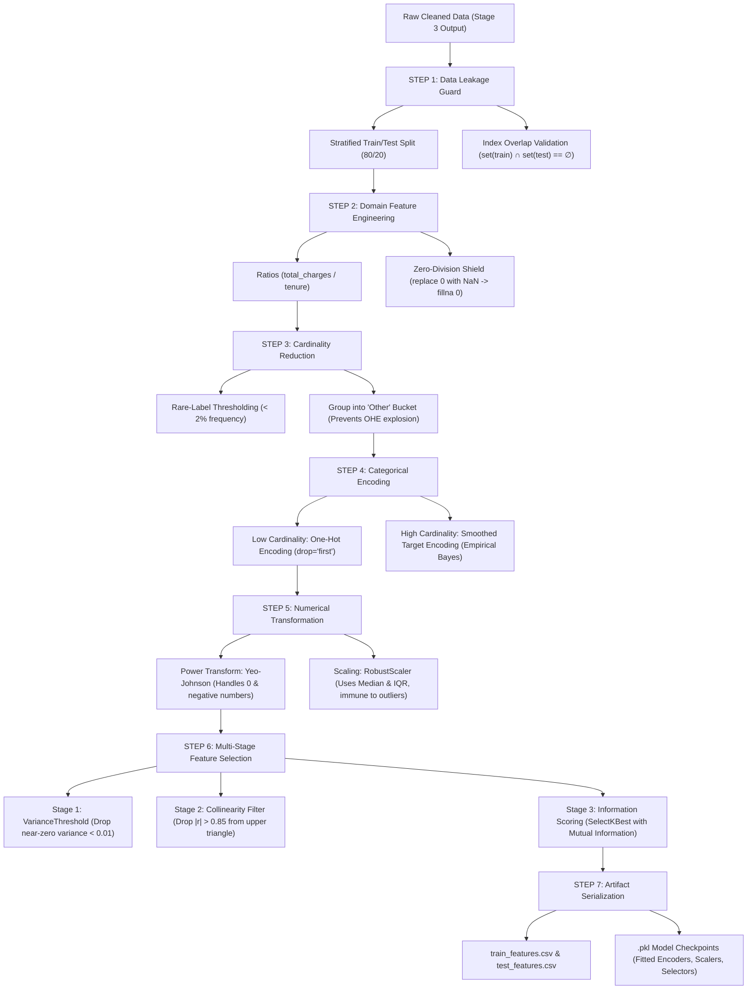

# 🧠 Stage 4: Feature Engineering, Transformation & Selection
> **CDAC PGCP-AI Master Study Guide | Mindmap, Distilled Notes & Interactive MCQs**

---

## 🗺️ 1. Complete Architecture Mindmap



---

## 📌 2. Core Concepts: The "Cheat-Sheet" Summary

| Step & Component | What it Does (In Plain English) | Why We Need It | Mathematical / Algorithmic Core | Golden Rule to Avoid Bugs |
| :--- | :--- | :--- | :--- | :--- |
| **1. Data Leakage Validator** | Splits data **first** before doing any transformations. | If you compute mean/mode/min/max on the whole dataset, test knowledge leaks into training! | $\text{train\_indices} \cap \text{test\_indices} = \emptyset$ | **Fit ONLY on Train**, then `transform()` both Train & Test. |
| **2. Domain Feature Builder** | Creates business metrics from combinations of columns. | Raw numbers alone don't capture velocity or rate (e.g., tenure vs charge). | $\text{charge\_per\_month} = \frac{\text{total\_charges}}{\text{tenure\_months}}$ | **Never divide by zero**: replace $0$ with `NaN`, then `fillna(0.0)`. |
| **3. Cardinality Reducer** | Groups rare categories (appearing $< 2\%$ of time) into `'Other'`. | Prevents One-Hot Encoding from exploding into hundreds of useless sparse columns. | $\text{Frequency} = \frac{\text{count}(c)}{N} < 0.02 \rightarrow \text{'Other'}$ | Calculate frequent categories on **Train only**; freeze them for Test. |
| **4. Categorical Encoder** | Converts text categories into numbers. | Machine learning models only understand matrices of numbers. | • **OHE**: Binary vectors ($k-1$ dummy cols)<br>• **Target Encoding**: $\frac{n \cdot \bar{y} + m \cdot \mu}{n + m}$ | Use `drop='first'` in OHE to prevent **dummy variable trap** (perfect multicollinearity). |
| **5. Numerical Transformer** | 1. Normalizes skewed shapes.<br>2. Puts features on same scale. | Skewed data hurts linear models; features with huge numbers dominate gradients. | • **Yeo-Johnson**: Power transform for $\mathbb{R}$<br>• **RobustScaler**: $\frac{X - \text{median}}{\text{IQR}}$ | Use **RobustScaler** instead of StandardScaler when outliers are present. |
| **6. Feature Selector** | 3-Step funnel to keep only the best, non-redundant features. | Having too many correlated or useless features causes overfitting & slow training. | 1. $\text{Var}(X) > 0.01$<br>2. Pearson $\|r\| < 0.85$<br>3. $\text{MutualInfo}(X, y)$ | Remove constant features **before** running correlation checks. |

---

## 🎯 3. Interactive Self-Test MCQs (Scenario-Based)

Try answering each question before checking the explanation!

---

### Question 1: Data Leakage
**Scenario:** You are building a churn prediction model. You fit `RobustScaler` on the entire customer dataset before splitting it into 80% train and 20% test sets. What critical flaw has occurred?
- **(A)** The model will fail with a `DimensionMismatchError`.
- **(B)** Data leakage: Test set distribution statistics (median and IQR) have leaked into the training pipeline, leading to overly optimistic test evaluation.
- **(C)** The test set will contain negative values that cannot be processed.
- **(D)** No issue; scaling should always be done on the full dataset to get the most accurate global parameters.

<details>
<summary>👉 Click to Reveal Answer & Explanation</summary>

**Correct Answer: (B)**  
**Explanation:** Any statistic (mean, median, IQR, frequent categories, target averages) must be calculated **exclusively on the training partition**. When you fit on the entire dataset, the model gains indirect knowledge of the test set's distribution, inflating evaluation metrics and failing in production.
</details>

---

### Question 2: Zero-Division in Domain Features
**Scenario:** In telecom telemetry, new customers have `tenure_months = 0`. You calculate `charge_per_tenure = total_charges / tenure_months`. What is the industry-standard way to engineer this feature safely in Pandas?
- **(A)** Drop all rows where `tenure_months == 0`.
- **(B)** Add `0.00001` to all numbers.
- **(C)** Replace `0` with `np.nan`, perform division, and then replace `[np.inf, -np.inf]` with `np.nan` followed by `.fillna(0.0)`.
- **(D)** Use integer division `//`.

<details>
<summary>👉 Click to Reveal Answer & Explanation</summary>

**Correct Answer: (C)**  
**Explanation:** Replacing `0` with `NaN` converts IEEE 754 division-by-zero into manageable floats rather than throwing errors. Masking infinities and filling with `0.0` ensures the new feature is cleanly defined for brand-new customers without losing data rows.
</details>

---

### Question 3: The Dummy Variable Trap
**Scenario:** When applying `OneHotEncoder` on a column `contract_type` having 3 distinct categories (`['month-to-month', 'one-year', 'two-year']`), why do we set `drop='first'`?
- **(A)** To reduce RAM usage by 33%.
- **(B)** To prevent perfect multicollinearity (the Dummy Variable Trap), where the $k$-th column is completely predictable from the first $k-1$ columns.
- **(C)** Because Scikit-Learn will raise a `ValueError` if all columns are kept.
- **(D)** It is only required for tree-based algorithms like Random Forest.

<details>
<summary>👉 Click to Reveal Answer & Explanation</summary>

**Correct Answer: (B)**  
**Explanation:** If you know someone is NOT on a 'month-to-month' and NOT on a 'one-year' contract, they MUST be on a 'two-year' contract ($x_3 = 1 - x_1 - x_2$). In linear models, keeping all $k$ columns results in a singular matrix (non-invertible $X^T X$).
</details>

---

### Question 4: Rare-Category Thresholding
**Scenario:** A feature `payment_method` has 50 categories. 48 of those categories appear in fewer than 0.5% of total records each. What happens if you One-Hot Encode this feature without cardinality reduction?
- **(A)** The model will become faster because sparse matrices take less RAM.
- **(B)** The dataset dimensionality will explode with 50 sparse columns, causing severe overfitting and high variance.
- **(C)** The imputer will fail with missing value exceptions.
- **(D)** The categorical encoder will automatically delete the 48 categories.

<details>
<summary>👉 Click to Reveal Answer & Explanation</summary>

**Correct Answer: (B)**  
**Explanation:** Long-tail categories create high-dimensional sparse vectors where decision trees will overfit to individual noise samples. Pooling categories with $< 2\%$ frequency into an `'Other'` bucket consolidates the signal and keeps feature count tight.
</details>

---

### Question 5: Power Transformation: Yeo-Johnson vs Box-Cox
**Scenario:** Your feature `monthly_profit` contains positive numbers, exact zeros, and negative numbers (losses). Which power transformation method can you use to normalize its distribution?
- **(A)** Box-Cox
- **(B)** Log10 transformation
- **(C)** Yeo-Johnson
- **(D)** MinMax scaling

<details>
<summary>👉 Click to Reveal Answer & Explanation</summary>

**Correct Answer: (C)**  
**Explanation:** Box-Cox strictly requires **strictly positive** values ($X > 0$). The Yeo-Johnson transformation extends the Box-Cox formulation to support zero ($X = 0$) and negative numbers ($X < 0$).
</details>

---

### Question 6: StandardScaler vs. RobustScaler
**Scenario:** A financial dataset has extreme outliers in `transaction_amount` (e.g. 99% of transactions are under \$100, but a few fraud transactions are \$5,000,000). Which scaler should you use?
- **(A)** `StandardScaler`
- **(B)** `RobustScaler`
- **(C)** `Normalizer`
- **(D)** `Binarizer`

<details>
<summary>👉 Click to Reveal Answer & Explanation</summary>

**Correct Answer: (B)**  
**Explanation:** `StandardScaler` uses the sample mean and standard deviation ($\mu, \sigma$), both of which are heavily distorted by extreme values. `RobustScaler` subtracts the **median** and divides by the **Interquartile Range ($IQR = Q_3 - Q_1$)**, making it immune to extreme outliers.
</details>

---

### Question 7: Feature Selection Funnel
**Scenario:** What is the correct, computationally optimal order for running multi-stage feature selection?
- **(A)** Mutual Information $\rightarrow$ Collinearity Filter $\rightarrow$ VarianceThreshold
- **(B)** VarianceThreshold $\rightarrow$ Collinearity Filter $\rightarrow$ Mutual Information
- **(C)** Collinearity Filter $\rightarrow$ Mutual Information $\rightarrow$ VarianceThreshold
- **(D)** Mutual Information $\rightarrow$ VarianceThreshold $\rightarrow$ Collinearity Filter

<details>
<summary>👉 Click to Reveal Answer & Explanation</summary>

**Correct Answer: (B)**  
**Explanation:** Always filter cheapest-first!
1. **VarianceThreshold** is $O(N)$ (super fast, drops constants).
2. **Correlation Matrix** is $O(N \cdot D^2)$ (drops redundant collinear pairs).
3. **Mutual Information** is $O(N \cdot D \log N)$ (computationally expensive statistical test, run only on the remaining refined feature subset).
</details>

---

### Question 8: High-Cardinality Target Encoding & Smoothing
**Scenario:** A categorical column `zip_code` has 5,000 unique values. Why do we apply **m-estimate smoothing** ($\frac{n \cdot \bar{y} + m \cdot \mu}{n + m}$) instead of raw category averages?
- **(A)** To convert float values to integers.
- **(B)** To prevent rare categories with small sample sizes ($n=1$ or $2$) from having extreme, overfitted target values (pulling them toward the global dataset average $\mu$).
- **(C)** To make the calculation run faster in parallel.
- **(D)** Because target encoding cannot be computed without a smoothing factor.

<details>
<summary>👉 Click to Reveal Answer & Explanation</summary>

**Correct Answer: (B)**  
**Explanation:** If a zip code has only 1 customer and they churned, its raw target mean is $1.0$ (100% churn rate), which is wildly unreliable. The smoothing formula weighs small categories toward the global average $\mu$, preventing severe overfitting.
</details>

---

### Question 9: PCA Application
**Scenario:** In [`test3.py`](file:///c:/Users/conne/Downloads/ML_CDAC_ALILOG/Day4/test3.py), you have `Height_cm` and `Weight_kg`. You run PCA with `n_components=1` and produce a single column `Body_Size_Score`. What does this single component represent?
- **(A)** The average of height and weight.
- **(B)** The first eigenvector (axis of maximum variance) that captures the strongest linear combination of height and weight.
- **(C)** The residuals of height regressed on weight.
- **(D)** The correlation coefficient between height and weight.

<details>
<summary>👉 Click to Reveal Answer & Explanation</summary>

**Correct Answer: (B)**  
**Explanation:** PCA finds orthogonal axes of maximum variance. The first principal component ($PC_1$) is the linear combination of standardized features that captures the largest possible percentage of total data variance.
</details>

---

### Question 10: Model Deployment Artifacts
**Scenario:** After training your Stage 4 feature pipeline, what must be exported to disk via `joblib.dump()` so the model can make predictions on live streaming data tomorrow?
- **(A)** Only the cleaned CSV files (`train_features.csv`).
- **(B)** The Python source code files (`O01` through `O07`).
- **(C)** The fitted transformer objects (`fitted_categorical_encoder.pkl`, `fitted_numerical_transformer.pkl`, `fitted_cardinality_reducer.pkl`, `fitted_feature_selector.pkl`).
- **(D)** The raw database tables.

<details>
<summary>👉 Click to Reveal Answer & Explanation</summary>

**Correct Answer: (C)**  
**Explanation:** At inference time, incoming raw JSON/CSV requests must pass through the **exact same fitted parameters** (same category mappings, scalers, and selected feature columns) before being passed to `model.predict()`.
</details>

---

## ⚡ 4. Quick Recall Formula Reference

```
1. Ratio Metric:
   Feature = Numerator / (Denominator.replace(0, NaN)) -> fillna(0)

2. Rare Label Threshold:
   Keep category if (Category_Count / Total_Rows) >= 0.02, else 'Other'

3. Smoothed Target Encoding:
   Value = (n * Category_Mean + smoothing * Global_Mean) / (n + smoothing)

4. Robust Scaling:
   Scaled_X = (X - Median) / (Q3 - Q1)

5. Correlation Filter:
   Drop Col_j if |Pearson_Correlation(Col_i, Col_j)| > 0.85
```
